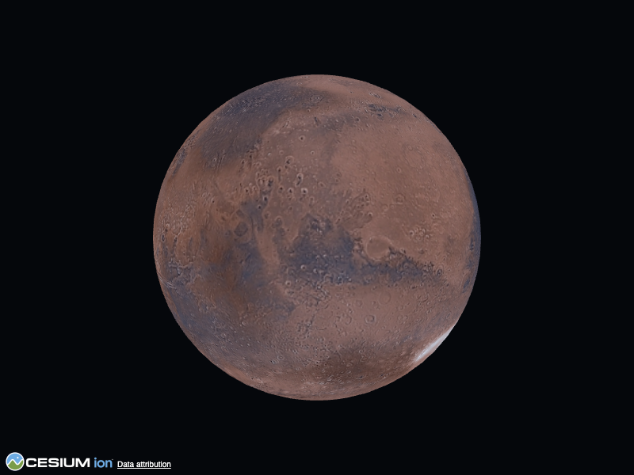

# MarsGIS

[](https://github.com/aaron43210/MARSGIS/actions/workflows/ci.yml)
[](LICENSE)
[](https://www.npmjs.com/package/mars-globe)

MarsGIS is a web GIS for Mars. It combines an interactive 3D globe built on CesiumJS with a
hyperspectral analysis engine that runs the Spectral Angle Mapper (SAM) on CRISM MTRDR cubes.
You can find a CRISM observation on the map, run SAM against a reference mineral spectrum, view
the result as a map layer and download it with full provenance.

<p align="center">
  
</p>

> **Scientific integrity.** SAM produces *candidate spectral matches*, not confirmed mineral
> deposits. Every result keeps the continuous spectral-angle raster next to the candidate mask
> and carries a required caveat. The bundled offline sample is synthetic and is labelled as such.

## Quick start

Requires Docker with the Compose plugin.

```bash
cp .env.example .env     # change POSTGRES_PASSWORD and SECRET_KEY for anything non-local
make up                  # builds and starts PostGIS, the backend and the frontend
```

- App: http://127.0.0.1:8080
- API: http://127.0.0.1:8000 (health at `/api/health`, interactive docs at `/docs`)

Stop with `make down`; `make help` lists every task.

Optional services:

```bash
docker compose --profile worker up -d    # Redis + arq worker (JOB_BACKEND=arq)
docker compose --profile tiles  up -d    # titiler sidecar for scaled-out tiling
make engine-run-sample                   # run SAM on the bundled synthetic sample
```

## Components

| Component | Stack | Role |
| --------- | ----- | ---- |
| `frontend/` | React 19, Vite 7, CesiumJS | The map application, served by nginx |
| `backend/` | FastAPI, SQLModel, rio-tiler | Catalogue, analysis jobs, on-the-fly result tiles |
| `engine/` | Python, numpy, rasterio | Standalone SAM engine: Python API, CLI and Docker image |
| `packages/mars-globe/` | TypeScript, CesiumJS | Reusable 3D Mars globe, [published on npm](https://www.npmjs.com/package/mars-globe) |

The backend uses SQLite by default and PostgreSQL + PostGIS in production, selected by
`DATABASE_URL`. Jobs run in-process by default or on arq + Redis. See
[docs/ARCHITECTURE.md](docs/ARCHITECTURE.md) for the design.

### mars-globe

The Cesium Mars setup is also available on its own:

```bash
npm install mars-globe cesium
```

```js
import { createMarsGlobe } from 'mars-globe';
createMarsGlobe('map', { defaultBasemap: 'viking' });
```

See [packages/mars-globe](packages/mars-globe/README.md).

## Development without Docker

Requires Node 24 and Python 3.12. See [docs/DEVELOPMENT.md](docs/DEVELOPMENT.md).

## Security

The development Compose stack is unauthenticated and binds only to `127.0.0.1`. Before exposing
it, enable `REQUIRE_API_KEY`, terminate TLS and put a reverse proxy in front of the backend. See
[SECURITY.md](SECURITY.md) for reporting vulnerabilities.

## Data and attribution

NASA data is fetched from public services at runtime and is not redistributed here. Courtesy of
NASA/JPL-Caltech/JHUAPL (CRISM/MRO), NASA/GSFC (MOLA), USGS/NASA (Viking MDIM 2.1) and NASA Mars
Trek. See [docs/DATA_LICENSES.md](docs/DATA_LICENSES.md).

## Documentation

- [docs/ARCHITECTURE.md](docs/ARCHITECTURE.md): system design, contracts and data flow
- [docs/DEVELOPMENT.md](docs/DEVELOPMENT.md): local setup, configuration and the engine CLI
- [docs/RELEASING.md](docs/RELEASING.md): versioning and releases
- [docs/evidence/](docs/evidence/): validation runs behind the 1.0.0 milestone
- [CONTRIBUTING.md](CONTRIBUTING.md): how to contribute

## Citation

If you use MarsGIS in research, please cite it using [CITATION.cff](CITATION.cff).

## License

Code is [MIT](LICENSE). The bundled synthetic sample data is CC0 and the documentation is
CC-BY-4.0; see [docs/DATA_LICENSES.md](docs/DATA_LICENSES.md).
